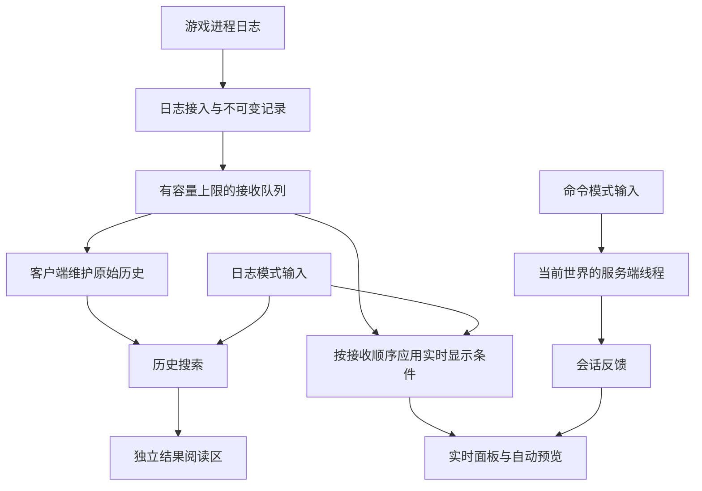

# 游戏内日志查看器与内置服务端终端

当前阶段与验证结果见[开发进度](../PROCESS.md)。

当前操作见[使用说明](../usage.md)，代码接入、运行时打包与后续数据流见[技术设计](technical.md)。

## 功能范围

提供一个客户端控制台，查看本机游戏进程的日志，并在单人游戏中向内置服务端提交 Minecraft 命令。支持 Fabric 和 NeoForge，使用 Architectury API 共享功能。

面板采用类似 Forts 的顶部滑出交互：新日志到达时短暂展开少量内容，热键展开大部分屏幕。日志模式提供实时显示筛选与历史搜索，命令模式提供服务端命令输入与反馈。

首版采集从日志接入完成后开始。可搜索的历史范围为本次启动中仍保留的原始记录；主菜单和远程多人游戏中仍可查看本机日志。

## 面板与输入模式

### 展开状态

| 状态 | 显示与输入 | 切换 |
| --- | --- | --- |
| 收起 | 隐藏面板或保留细边，不占用输入 | 符合提示条件的新日志触发预览，热键直接展开 |
| 预览 | 显示少量最新日志，不抢鼠标和键盘 | 超时收起，热键完整展开 |
| 展开 | 显示日志、模式切换、状态栏与输入行 | Esc 或关闭按钮收起；仅查看模式热键开关 |

预览使用 HUD 绘制，展开后使用原生 `Screen` 接收输入。两者共享布局和日志视图。界面采用半透明深色背景、紧凑行距、日志级别颜色和短时滑动动画。

日志视图位于底部时自动跟随新记录；上翻阅读后保持位置，显示“新增 N 条”，点击提示或按 End 回到底部。计数只包含允许显示的新日志。

连续到来的日志延长预览时间，不重复播放展开动画；自动预览设置最长持续时间。采集范围、实时显示筛选和自动提示条件分别管理，提示只能由允许显示的日志触发。

### 输入模式

| 模式 | 固定前缀 | 示例 | 执行位置 |
| --- | --- | --- | --- |
| 日志模式 | `$` | `$ filter level WARN` | 客户端本地命令 |
| 命令模式 | `#` | `# time set day` | 当前内置服务端 |

前缀由界面显示，输入和提交内容不包含前缀。模式通过 Shift+Tab 切换，输入行末尾显示组合键提示，各自保留输入草稿、输入历史与补全内容。展开状态与输入模式独立管理。当前背景与线性开合动画的具体表现见[使用说明](../usage.md)。

日志模式补全本地命令、参数和日志级别；命令模式使用内置服务端实际的命令树。未知本地命令显示用法提示，不转发到服务端。

没有可用的内置服务端时，命令模式禁用，日志模式继续可用。热键注册到游戏按键设置；聊天框等文本输入界面遵循输入焦点规则，关闭面板后恢复仍有效的原界面和输入焦点。

## 实时显示筛选：filter

`filter` 只控制规则生效后收到的新日志是否追加到实时面板，不重筛已经显示的内容。原始历史保留未通过显示筛选的记录。

| 命令 | 行为 |
| --- | --- |
| `filter level WARN` | 后续只显示指定级别的日志 |
| `filter keyword failed to load` | 使用 `keyword` 后的完整文本筛选后续日志，支持空格 |
| `filter reset level` | 清除级别条件 |
| `filter reset keyword` | 清除关键词条件 |
| `filter reset` | 清除全部条件 |
| `filter show` | 显示当前条件 |

级别支持 TRACE、DEBUG、INFO、WARN、ERROR、FATAL，名称忽略大小写，按精确级别匹配。关键词按忽略大小写的普通文本匹配消息与异常堆栈。级别与关键词条件取交集，重复设置同一条件时替换旧值。

规则生效点按接收顺序确定，已接收的记录不重新应用新规则。`filter reset` 只恢复后续记录的显示，不补放此前被隐藏的内容。修改条件不触发自动预览。

当前条件与本地命令反馈显示在状态栏，不受日志筛选影响。服务端命令回显与结果也不受 `filter` 影响。

## 历史搜索：grep

```text
grep -k "<keyword>" -l <level> [-t1 "<start time>"] [-t2 "<end time>"]
```

`grep` 搜索提交查询时已保留的原始日志，包括被 `filter` 隐藏的记录，不使用当前实时筛选条件。参数顺序可调整；包含空格的参数使用双引号。

| 参数 | 含义 |
| --- | --- |
| `-k` | 关键词，匹配规则与 `filter keyword` 相同 |
| `-l` | 日志级别，匹配规则与 `filter level` 相同 |
| `-t1` | 可选起始时间，包含该时间点；省略则不限制下界 |
| `-t2` | 可选结束时间，包含该时间点；省略则不限制上界 |

所有已提供的条件取交集。`-t1` 与 `-t2` 均省略时，在全部可用历史中按关键词和级别搜索；单独提供一个时间参数时只限制对应方向。

时间使用本机时区，支持 `HH:mm:ss` 和 `YYYY-MM-DD HH:mm:ss`。短时间按提交查询当天解析，跨日查询使用完整日期。显式给出时间参数时必须提供有效值；起始时间晚于结束时间时显示输入错误。

```text
$ grep -k "failed to load" -l ERROR
$ grep -k "timeout" -l WARN -t1 "14:30:00"
$ grep -k "connection" -l INFO -t1 "14:30:00" -t2 "15:00:00"
$ grep -k "timeout" -l WARN -t2 "15:00:00"
```

### 搜索结果阅读区

结果在面板内部的独立边框区域显示，采用类似 `less` 的阅读交互。顶部显示查询条件、匹配条数和实际可搜索的历史时间范围，底部显示当前位置；没有匹配时显示空结果提示。

| 操作 | 行为 |
| --- | --- |
| ↑ / ↓、鼠标滚轮 | 逐行滚动 |
| PageUp / PageDown | 翻页 |
| Home / End | 跳至首尾 |
| ← / → | 长行未换行时横向滚动 |
| q / Esc | 退出阅读区并返回实时面板 |

阅读区获得键盘焦点时，方向键用于阅读，命令输入暂停；Esc 优先关闭阅读区。退出后恢复输入草稿与实时面板的阅读位置。

结果固定为提交查询时的内容，按日志接收顺序排列。后台继续接收新日志，不插入当前结果、不触发覆盖阅读区的自动预览，也不改变当前滚动位置。历史淘汰不应使已打开的结果跳动；结果所需记录在阅读期间保留，关闭后释放。

查询计算不阻塞界面绘制，关闭阅读区可取消未完成的查询。结果只作为界面内容，不重新写入原始历史或日志系统。

## 内置服务端命令

命令模式执行当前内置服务端注册的 Minecraft 命令，支持原版与其他 Mod 的命令。输入文本、直接反馈和执行结果进入控制台时间线，使用独立类型标记。

执行流程为：客户端提交当前世界会话的命令，服务端线程确认会话有效并执行，再将反馈送回客户端。补全也从当前服务端命令树获取。渲染线程不直接执行服务端命令，不阻塞等待服务端返回。

草稿默认使用原生服务端控制台命令源：具有服务端控制台权限，不受玩家“允许作弊”开关限制；没有玩家实体，`@s` 不自动指向玩家，相对坐标基于服务端命令源的位置和维度。输入区显示“本地服务端控制台”。

每次进入世界建立独立命令会话。退出世界或服务端停止时结束会话，拒绝新提交并结束未完成的补全与反馈等待；旧会话的反馈不进入新会话。结果尚未确定的命令不自动重试。

局域网开放后的命令可用性保留为待确定项。远程服务器控制、RCON、系统 Shell 和脚本执行不在首版范围内。

## 日志采集与存储

在客户端初始化阶段向现有 Log4j2 系统注册一个 Appender，采集本机进程中客户端、内置服务端和其他 Mod 经该日志系统产生的事件。记录接收序号、事件时间、级别、线程、logger、消息与异常堆栈；来源按实际信息显示。

Appender 在回调内提取不可变记录，写入有容量上限的并发队列，不保留可复用的原始日志事件，不调用界面，也不向同一日志系统再次写入采集反馈。显示筛选不修改游戏日志系统的采集级别。

客户端线程按数量或时间预算批量接收记录，维护原始历史、实时显示结果和面板状态。原始历史同时设置条数与总大小上限，超限时淘汰旧记录。队列溢出与历史淘汰分别显示计数，并更新可搜索范围。

原始历史与实时视图共享不可变记录；实时视图保留每条记录接收时的显示结果，历史查询直接读取原始历史。异常堆栈作为一条可展开记录，界面只排版和绘制可见内容。

日志接入属于客户端进程生命周期。切换世界不重复注册 Appender，退出客户端时卸载。命令会话属于当前世界生命周期，与日志接入分别管理。



## 代码结构与接入

| 位置 | 职责 |
| --- | --- |
| `common/` | 共享记录模型、筛选与查询规则、面板状态、日志接入、命令会话及共享界面 |
| `fabric/` | Fabric 客户端入口、生命周期、按键与渲染事件接入 |
| `neoforge/` | NeoForge 客户端入口、生命周期、按键与渲染事件接入 |
| `docs/plan/` | 本计划 |

各平台通过公共入口调用共享功能。依赖方向与开发规范遵循根目录 [AGENTS.md](../../AGENTS.md)。纯规则不依赖日志库和 Minecraft 界面类型，外部依赖由对应接入代码转换；平台接入不重复定义筛选和交互规则。

共享与平台模块已配置 Kotlin 编译，两端通过客户端入口调用共享控制台。热键在主菜单、世界选择、聊天框、物品栏和游戏中均可打开面板，关闭后恢复原界面及其输入状态；存档外仅可使用日志模式。新增业务代码采用 Kotlin 惯用写法。

优先使用 Architectury 提供的公共事件，平台专属接入放入对应模块。界面、输入、命令源与权限接口按目标 Minecraft 版本核对；具体版本以 [gradle.properties](../../gradle.properties) 和 [build.gradle](../../build.gradle) 为准。

## 实施顺序

| 阶段 | 工作内容 | 完成标准 |
| --- | --- | --- |
| 1. 基础接入 | Kotlin 配置、两端客户端入口、可配置热键、空面板与模式切换 | 两端都能打开、关闭面板并正确恢复输入焦点 |
| 2. 实时日志与筛选 | 日志接入、原始历史、实时视图、`filter` 命令、自动滚动 | 新日志按规则显示，修改规则不改变既有显示记录，被隐藏记录仍可保留 |
| 3. 历史检索 | `grep` 参数解析、时间范围、查询执行、独立阅读区 | 能检索被隐藏的日志，阅读结果时内容和位置稳定 |
| 4. 预览交互 | 收起、预览、展开状态，滑动动画，提示条件与超时 | 新日志按条件触发预览，上翻与阅读搜索结果时不被打断 |
| 5. 服务端终端 | 世界会话、命令执行与反馈、Tab 补全 | 单人世界能执行并补全命令，退出世界后会话结束；历史输入已在阶段 2 接入 |
| 6. 使用完善 | 复制、堆栈展开、配置入口、资源声明与使用文档 | 两个加载器的日常交互一致，日志密集时界面仍可正常操作 |

## 验证安排

编译、构建与游戏内验证覆盖 Fabric 和 NeoForge。实际检查日志密集时的帧率和容量控制、实时滚动、输入焦点、搜索阅读、服务端命令权限与世界切换。

筛选和搜索重点检查：规则只影响后续日志；隐藏记录仍可检索；两个时间参数均省略、分别省略或全部提供时范围正确；搜索结果不随新日志或历史淘汰跳动。命令重点检查：退出世界后无法继续提交，旧世界反馈不进入新会话。

自动化测试按明确业务行为需要添加，放在模块独立测试源码集中，测试依赖和替身不进入生产产物。优先覆盖实际需要验证的筛选边界、时间条件、展开状态与滚动规则。构建通过和游戏内验证分别记录结果。

## 草稿默认值与待确定项

| 项目 | 当前安排 |
| --- | --- |
| 面板位置 | 默认从顶部展开 |
| 预览高度 | 建议 4～6 行，实际值在界面调试时确定 |
| 展开高度 | 建议屏幕高度的 60%～70%，实际值在界面调试时确定 |
| 游戏暂停 | 默认打开面板时继续运行单人游戏 |
| 命令身份 | 默认使用服务端控制台身份，具体行为见“内置服务端命令” |
| 提示节奏 | 停留时长、最长持续时间及默认提示级别在交互阶段确定 |
| 容量与预算 | 队列、原始历史、单条记录和活动查询的上限，以及每次接收预算，在真实日志量下确定 |
| 局域网开放 | 是否继续允许本地主机使用命令模式，接入命令阶段前确定 |
| 默认热键 | 反引号（grave accent），可在游戏按键设置中修改，实际冲突情况待两端运行验证 |

## 后续范围

启动早期日志回读、已淘汰记录的文件查询、跨次启动的历史搜索另行安排。引入文件查询后扩展历史搜索的数据来源，保留 `filter` 仅影响后续实时显示的语义。
