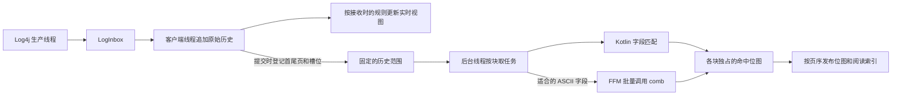

# grep 历史搜索架构

阶段 3 在客户端搜索本次启动仍保留的日志。日志正文由客户端线程追加和淘汰；提交查询时固定记录范围，后台按页扫描，ASCII 字段可经 Java FFM 调用 Zig comb 加速。搜索期间的堆分配目标是每扫描一条记录、每增加一个命中均为 0 B。一次命令解析、任务提交和屏幕可见行可以有少量分配。命令语法与阅读区按键见[主计划](README.md#搜索结果阅读区)。

当前实现：JVM 单线程扫描是完整路径；发布 JAR 附带 Windows、Linux、macOS 的 x86_64/aarch64 comb 库，可用时按 64 条一批走原生扫描，非 ASCII、超批容量、加载或调用失败均回退 JVM。分块并行尚未接入。

## 接入位置与数据流

`LogInbox` 在同一把锁内给入队记录编号、保存当时的显示规则。`LogCapture.drain` 在客户端 tick 将记录交给 `LogHistory.accept`。一条记录即使被实时筛选隐藏，也已经进入原始历史。查询的提交点取客户端处理有效命令、取得历史范围的那一刻。仍在 inbox 的记录留给下次查询。显示筛选、命令回显和已淘汰记录均不参与确定搜索输入。[LogInbox](../../common/src/main/kotlin/com/nts/ingamecnl/client/log/LogInbox.kt) · [LogCapture](../../common/src/main/kotlin/com/nts/ingamecnl/client/log/LogCapture.kt) · [LogHistory](../../common/src/main/kotlin/com/nts/ingamecnl/client/log/LogHistory.kt)



`common` 的客户端日志包提供一个查询入口，负责解析后的查询、线程调度和结果所有权。`LogHistory` 负责登记有序页范围，向搜索和实时视图提供按页读取的入口。GUI 只提交、取消、读取状态和当前页。FFM 适配器仅承担数据布局、加载和调用。两个加载器复用这一实现。Zig 构建入口在 [common/src/native](../../common/src/native/build.zig)，Gradle 在 `:common:processResources` 前按六个目标运行 `zig build -Drelease -Dtarget=<triple>`，把各平台动态库复制到共享资源。

## 动态尾部与静态分块

**容量与现状。** 条数默认 `Int.MAX_VALUE`，最大 `Long.MAX_VALUE`。文本量默认 128 MiB，最大 2 GiB，只累计消息和异常文本的 UTF-8 字节数。空消息也占一个条目，线程名、logger 名和 JVM 对象另占内存。原始历史已按 1024 条分页；条数、文本量、页号和查询计数使用 `Long`，页内槽位和 FFM 批下标仍为 `Int`。实时视图保留接收时的筛选结果，查询快照只读取已封存页和当前尾页。[容量定义](../../common/src/main/kotlin/com/nts/ingamecnl/log/LogLimits.kt) · [文本计数](../../common/src/main/kotlin/com/nts/ingamecnl/client/log/LogRecord.kt)

**单写者与提交。** 每页建议从 1,024 条起测，随写入分配。客户端线程独占尾页，满页封存。提交有效查询时检查预算、封存有内容的尾页，登记首个有效页及槽位、末页及其有效条数；下一条日志到达时才开新页。空历史及两次提交之间没有追加时都不另开页。登记与追加、淘汰、配置缩容在同一线程串行。提交成本为 O(1)，任务入队后工作线程可安全读取已发布的不可变槽位。搜索保留提交时的范围，后来的写入、队首淘汰以及配置缩容只更新实时历史的边界。

**并行与归并。** 一个线程起步，大查询试用至多四个工作线程并为游戏留出 CPU。调度器沿页链顺序分派，每页归一个工作线程，页内每 64 条共用一个命中字。固定大小的在途页窗口限制任务和乱序结果数量；连续页完成后按页序归并，才复用临时缓冲。每页统计有效记录的事件时间最小值、最大值，零命中页也参与。阅读区按接收顺序排序，事件时间倒序也能得到正确范围。

**计数与溢出。** 条数、序号、页号、命中总数、阅读位置和字节累计用 `Long`，只有页内槽及 FFM 批次偏移用窄整数。2 GiB 恰为 2,147,483,648 字节，换算从乘法起使用 `Long`。页数向上取整使用商和余数；末尾用页号与有效槽数表示，避免最大序号加一。累计预算前先检查剩余额度；下一接收序号不可表示时停止编号并报告容量耗尽，已有记录仍可读。

## 内存布局与所有权

| 资源 | 分配与所有权 | 释放时机 |
| --- | --- | --- |
| 历史页 | 一页保存一份不可变记录引用与可见位。页链节点和记录页分离，阅读区仅持有记录页 | 实时历史、登记的查询及阅读结果均释放后才可回收 |
| 查询范围 | 每面板最多两个代号，包含正在取消的任务。协调器登记从最早尚未归并的页到固定尾界的保护范围 | 归并后推进保护范围；取消后等所有读取者退出再撤销登记 |
| 阅读索引 | 仅保存命中页引用、位图及累计命中数。目录按固定容量分层分段，用 `Long` 序号定位，无单数组长度限制 | 关闭时交后台分批释放，实际释放后归还预算 |
| FFM 工作区 | 每个原生工作线程复用有界字节区、描述表和一个输出字，建议字节区从 64 KiB 起测 | 工作线程退出时关闭自己的 `Arena.ofConfined()` |

**预算按实际页数计算。** 写者在追加、淘汰时维护当前页数与整页保留成本，覆盖字符串、记录、引用、数组、空槽及页元数据。提交时以 O(1) 预留整段历史都被淘汰时仍需保留的内存、全命中时的分段索引及在途工作区。预留只记账。首尾部分有效的页按整页计费，重叠查询可保守重复计费。预算不足在扫描前返回容量错误，保留已打开的结果；额度释放后可重提。归并后，仅对实际释放的页和不再需要的索引归还额度。

每 64 个槽的命中位占 8 字节。例如连续 1,048,576 条满页记录全部命中时，位图为 128 KiB，目录和旧正文另计。稀疏命中也可能保留一整页正文；记录页本身不引用后继页，因而不会连带保留后续零命中页。阅读第 N 条结果时按累计命中数定位页，再从页内位图选取槽位，仅排版可见行。扫描循环复用工作区，结果索引的按页分配单独计量。

## comb 的使用边界

上游公开了 `comb.LiteralMatcher.init(needle, case_sensitive, unicode_mode)` 和 `findFirst(haystack, from)`。关键词由调用方持有，空关键词返回 `EmptyNeedle`。本设计核对的提交为 `02546de0e1542acf66ac3757166326718a57fda0`。直接向字面量匹配器传字段切片，消息与异常分开调用，任一命中就标记该记录一次。字段内部保留换行和 NUL。上游 `Engine` 提供自己的线程池、按行组织结果、按完成顺序发布；这里由 JVM 掌握分块、取消和展示顺序。[公开模块](https://git.urverk.org/urverk/comb/src/commit/02546de0e1542acf66ac3757166326718a57fda0/src/root.zig) · [字面量实现](https://git.urverk.org/urverk/comb/src/commit/02546de0e1542acf66ac3757166326718a57fda0/src/literal.zig) · [上游使用说明](https://git.urverk.org/urverk/comb/src/commit/02546de0e1542acf66ac3757166326718a57fda0/README.md)

先按精确级别及毫秒时间范围筛选，再检查字段。关键词与字段都完全由 ASCII 构成时，后台可直接把码元写进复用的字节区，调用 `LiteralMatcher.init(needle, false, false)`。写入过程中发现非 ASCII 就回退该字段的写入位置，直接在原字符串上执行与 `DisplayFilter` 共享的 Kotlin 字面量判断。非 ASCII 关键词整个查询走 JVM。这样 ASCII 的 `k` 遇到 Kelvin 符号、土耳其语 I、补充平面字符或截断产生的孤立代理项时也能按现有规则处理。消息与堆栈可分别走两条路径，结果按记录取并集。不可先用 comb 的 Unicode 筛掉候选再交给 JVM 复核，那会丢掉两者大小写规则不一致时的命中。[现有匹配规则](../../common/src/main/kotlin/com/nts/ingamecnl/client/log/DisplayFilter.kt)

**调用粒度。** 同一工作区收集多个字段，再一次 downcall；空间满就结束当前批次。超出单批容量的字段整段走 JVM，关键词超过已测长度上限也走 JVM，不拆开字段漏掉跨边界命中。所有 JVM 判定至少在每条记录前检查取消。原生调用同步处理有限批次，在返回后检查取消；通过限制每批字节数与原生关键词长度控制最慢批耗时，特别要测长公共前缀。小查询直接用 JVM，是否启用批量 FFM 取决于包含字段检查、复制和归并的端到端实测。

### 本项目的 C ABI v1 草案

```c
uint32_t igcnl_grep_abi_version(void);
int32_t igcnl_grep_scan_ascii_v1(
    const uint8_t *needle, uint32_t needle_len,
    const uint8_t *text, uint32_t text_len,
    const igcnl_field_v1 *fields, uint32_t field_count,
    uint64_t *out_mask);
```

`igcnl_field_v1` 为三个按顺序排列的 `uint32_t`，分别表示字节偏移、字节长度和逻辑块内记录下标。C/Zig/FFM 使用相同的本机字节序、大小与对齐；v1 每批只属于一个逻辑块，下标范围 0～63，同一记录允许两个字段。输出固定一个对齐的 64 位字，表示本批命中，JVM 校验有效位后与该块此前的命中按位或。空候选直接在 JVM 完成。Java 按真实 segment 大小核对所有声明长度、表项数、输出空间与非空指针；Zig 在切片前核验上限、下标及 `offset <= text_len && len <= text_len - offset`，算数使用显式检查。C 指针本身无法证明可访问长度。

包装层在栈上构造借用关键词的 matcher，扫描期间只读输入，成功后才一次写入输出。不保存指针、回调 Java、创建线程或分配结果。FFM 缓存函数句柄和布局，使用定型 downcall；始终在所属线程访问工作区，FFM 调用返回后才能覆盖其内容。正常返回值约定 `OK`、`BAD_ARGUMENT`、`BAD_LAYOUT`，在 JVM 边界映射为类型化结果。Zig error union、panic、指向临时内存的错误消息都不穿越 ABI。调用期间的原生崩溃能终止整个游戏进程，因此必须在独立测试进程中验证畸形描述表、极限长度和持续取消，不能指望 JVM 捕获原生崩溃。

## 输入、故障与退出

解析器一次读取提交时间、本机日期及时区，参数顺序自由。严格处理引号、缺值、重复或未知选项、未知级别及空关键词。时间用严格日历年份 `uuuu-MM-dd`，短时间共享同一基准日期。按现有计划将给定秒转换为具体时间点，以 `startMillis <= timeMillis <= endMillis` 判定；例如结束值 `15:00:00` 包含 `.000`，不含 `.001`。建议对夏令时跳过或重复的本地时间返回明确输入错误，避免静默选错一小时。[命令契约](README.md#历史搜索grep)

| 情形 | 给用户的结果 | 重试、回收与诊断 |
| --- | --- | --- |
| 语法、时间或级别无效 | 指出出错参数，保留草稿和当前结果 | 输入修正后可提交，解析通过前不登记页范围、不取消旧结果 |
| 历史为空、没有命中 | 正常完成，显示 0 条和实际可搜范围 | 有效空结果；队列丢弃数和历史淘汰数单独展示 |
| 查询数或内存预算达到上限、任务提交遭拒 | 当前无法启动查询，保留草稿 | 资源释放后可重提；撤回本次预留。部分任务已启动时先取消，待退出后再释放页和预算 |
| 原生库缺失、架构不符、native access 受限、ABI 不匹配，或工作区分配失败 | 可用 JVM 路径完成同一份查询 | 在调用前选好路径；对当前会话停用不可用的原生能力。记录一次原因与平台信息，避免每次查询重复加载 |
| 原生返回坏布局、未知状态或越界命中位 | 终止该次查询，提示搜索失败，无部分结果 | 丢弃批次输出、取消同组任务、禁用该进程的原生后端。后续查询走 JVM。记录 ABI、块号和状态，不抄日志正文 |
| 关闭阅读区、替换查询、游戏退出 | 立即解除界面占用，旧结果不得弹回 | 先作废查询代号，再通知工作线程取消。尚未启动的任务撤销并登记完成。最后一个实际退出的任务负责释放，客户端线程不等待 downcall |
| 工作线程异常或执行结果未知 | 当前查询失败；由用户决定是否重提 | 不发布未完成的结果索引，不自动重发未知调用。保留首个原因，回收资源走同一完成路径；JVM 致命错误交给运行时处理 |

每个任务恰好报告一次完成，无论有没有开始执行。协调器在所有任务完成后独占结果，通过客户端执行队列交付；发布时再次核对查询代号和阅读区是否还在。交付遭拒、过期以及异常路径都由当前所有者释放页和预算。阅读区接管成功后才转移释放责任。停止客户端时停止接纳新查询、取消任务、唤醒空闲线程，由后台等运行中的 FFM 返回并关闭工作区，之后再释放库的生命周期资源。日志属于整个客户端，切换世界不重置历史。诊断通过不回灌 Appender 的渠道限频输出，玩家只看到可本地化的错误类型。

## 构建、实施与验证

1. **先做可对照的 JVM 路径。** 在现有本地命令入口接入分页历史、解析、范围登记、单工作线程及阅读区，用现有字符串规则产出按序结果。覆盖级别和时间交集、被隐藏记录、同条双字段命中、字段内换行、字段分界、截断及倒序时间。用确定的线程交错验证提交后追加、队首淘汰、取消尚未启动的任务、批次返回前关闭以及旧回调晚到。
2. **单独验证 Zig 边界。** 原生目录已通过 `zig fetch` 固定 comb 提交 `02546de0e1542acf66ac3757166326718a57fda0` 与内容哈希，`build.zig` 构建动态库并仅导出 v1 入口；`zig build test` 覆盖版本、命中合并和越界描述，独立 FFM 进程验证符号、布局与返回码。后续仍需补长度溢出、未知状态及非 ASCII 混合字段的系统性畸形输入测试。[本地包配置](../../common/src/native/build.zig.zon) · [上游包配置](https://git.urverk.org/urverk/comb/src/commit/02546de0e1542acf66ac3757166326718a57fda0/build.zig.zon)
3. **接入分块并行并定量选路。** 当前是 JVM/FFM 单线程，未做分块并行。对同一份记录回放比较 JVM 单线程、JVM 分块、FFM 单线程、FFM 分块四组，逐条比对命中序号与顺序。分别回放空历史、短历史、默认文本容量及接近 2 GiB 的历史；用短记录和空消息单独压测条数。通过构造页号和计数测试跨越 Int.MAX_VALUE、逼近 Long.MAX_VALUE、配置缩容和预算拒绝。负载覆盖短 ASCII、中文混合、最长堆栈、全命中、零命中、反复替换、打开旧结果同时持续写满历史。统计冷启动和预热后的查询 p50/p95/p99、取消延迟、客户端提交耗时、帧时间、实际复制字节、每线程分配和峰值堆外内存。JFR 加 GC 日志对比相同回放下关闭 grep 的基准；用分配计数测热循环，单列命令和 UI 分配。
4. **确定可发布参数。** 建议初始目标为满容量提交 p99 ≤ 1 ms、扫描循环 0 B/记录且无逐命中对象分配、取消 p99 ≤ 50 ms。持续满负荷运行并反复关闭阅读区后，被保留的页数、结果索引段数、原生工作区数和存活堆回到预期水平；以固定硬件、JDK、收集器和堆大小对比帧时间与 GC 暂停 p99。记录机器、样本量、预热和最坏样本。这些是待测目标。只在端到端 p95 改善且帧时间与分配达标的负载区间启用原生或多线程，其他区间保留 JVM 单线程。
5. **验证两个加载器的发布 JAR。** Gradle 调用 Zig 交叉编译 Windows、Linux、macOS 的 x86_64/aarch64 动态库，并作为共享资源打入两个平台的发布 JAR；构建机没有 Zig 时跳过原生资源，运行时自动回退 JVM。Windows x86_64 已完成独立 FFM 调用验证；Linux、macOS 产物需在对应系统上实际加载确认。FFM 加载失败、ABI 错配和禁止原生访问时同一查询走 JVM。运行两端 Wrapper 构建，实际启动客户端查询、关闭并退出游戏。阅读区焦点、滚动位置和自动预览由使用者在游戏中确认。[项目构建与运行](../usage.md)
