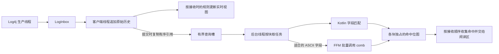

# grep 历史搜索架构

阶段 3 在客户端搜索本次启动仍保留的日志。建议保留一份 JVM 日志正文，由客户端线程处理追加和淘汰。提交查询时固定记录范围，后台按块扫描，满足条件的批次经 Java FFM 调用 Zig comb。搜索期间的堆分配目标是每扫描一条记录、每增加一个命中均为 0 B。一次命令解析、任务提交和屏幕可见行可以有少量分配。命令语法与阅读区按键见[主计划](README.md#搜索结果阅读区)。

## 接入位置与数据流

`LogInbox` 在同一把锁内给入队记录编号、保存当时的显示规则。`LogCapture.drain` 在客户端 tick 将记录交给 `LogHistory.accept`。一条记录即使被实时筛选隐藏，也已经进入原始历史。查询的提交点取客户端处理有效命令、取得历史范围的那一刻。仍在 inbox 的记录留给下次查询。显示筛选、命令回显和已淘汰记录均不参与确定搜索输入。[LogInbox](../../common/src/main/kotlin/com/nts/ingamecnl/client/log/LogInbox.kt) · [LogCapture](../../common/src/main/kotlin/com/nts/ingamecnl/client/log/LogCapture.kt) · [LogHistory](../../common/src/main/kotlin/com/nts/ingamecnl/client/log/LogHistory.kt)



`common` 的客户端日志包提供一个查询入口，负责解析后的查询、线程调度和结果所有权。`LogHistory` 只增加一个将原始记录按序写入已借用引用数组的操作。GUI 只提交、取消、读取状态和当前页。FFM 适配器仅承担数据布局、加载和调用。两个加载器复用这一实现。Zig 构建入口在 [common/src/main/native](../../common/src/main/native/build.zig)。

## 动态尾部与静态分块

**一处追加，多处只读。** 现有客户端线程就是动态尾部的唯一写者。写者可在 tick 继续淘汰队首、追加队尾。每次有效查询按接收顺序复制尚存的不可变 `LogRecord` 引用到固定大小的查询槽。最后一个未满块只复制当时有效的前缀。后台只读查询槽，因而能把尾块和所有满块用同一种算法扫描。无需常驻一个线程追新日志，也无需给历史队列加读锁。比如提交时历史为序号 100～299，即使 100 随即淘汰且 300 随即写入，这次仍只搜 100～299。结果打开期间继续保留其中命中的记录。

这个选择需要按当前历史容量重新评估。历史条数上限默认 `Int.MAX_VALUE`、最大 `Long.MAX_VALUE`，文本量上限默认 128 MiB、最大 2048 MiB，实际保留量通常受文本上限约束。提交时复制引用必须按本次实际可搜索条数和字节预算准入，不能假设固定的 2,000 条或 16 KB；客户端只做容量检查、引用复制和调度，扫描、统计时间范围、结果压缩均在后台做。若实测复制超出提交预算，再让历史以固定页存储，借用满页、单独复制首尾有效区。届时页必须在所有读者退出后才能复用。

**分工与发布。** 起测按 64 条记录划一个逻辑块，块数按本次实际可搜索条数计算，不预设固定上限。仅在有工作时唤醒固定工作池。以一个工作线程起步，大查询试用 `min(4, max(1, 可用逻辑核数 − 2), 块数)` 个。一个查询投递至多每线程一个任务，线程通过同一原子游标领取下一个块，长异常堆栈可分摊给不同线程。单记录始终归一个线程。64 条块独占一个对齐的 64 位命中字，末块只使用有效位。线程扫描完通过有内存可见性保证的完成计数交接，最后完成者按块号、块内序号原地向前压缩引用并清空数组尾部。结果顺序与线程抢到块的顺序无关。

每块单独统计所有输入记录的事件时间最小值、最大值。即使级别不符或零命中也参与统计。合并后阅读区显示提交时整个可搜历史的实际范围，空历史则显示无可用范围。事件时间可能倒序，直接按接收序号二分时间会漏记录。

## 内存布局与所有权

| 资源 | 分配位置和上界 | 释放时机 |
| --- | --- | --- |
| 日志正文 | 沿用历史和实时视图共享的不可变 `LogRecord`，包括消息和异常字符串。搜索不维护第二份正文索引 | 历史淘汰且查询、阅读区、实时视图都释放引用后，由 JVM 回收 |
| 查询槽 | 首次使用时按本次提交实际可搜索条数分配引用数组、每块一个命中字和时间范围，并按字节预算准入；不得按历史条数上限分配。每个面板最多占两个槽，覆盖旧查询取消与新查询提交的短暂重叠 | 完成时清除未命中引用。关闭阅读区后清除命中引用。槽归还前清除有效区，含所有失败分支 |
| FFM 工作区 | 每个实际使用原生搜索的线程延迟分配一次，建议从 64 KiB 字节区加定长描述表、输出位图起测。关键词放在线程工作区的保留区，批次复用同一段内存 | 工作线程退出时关闭自己的 `Arena.ofConfined()`。首次分配、动态库加载均在后台 |
| 阅读区 | 按位置索引查询槽压缩后的前缀，只为当前可见页排版；缓存限制为固定页数 | 关闭时交还槽，字体或尺寸改变时只清排版缓存 |

查询槽按本次实际可搜索条数分块，64 条一块、每块一个 64 位命中字；不再按固定 2,000 条估算位图或引用数组。即使全部命中也用同一份引用数组。这里需要分开统计两笔费用：数组大小随本次提交的实际条数增长，历史滚动后仅被阅读区持有的旧正文却可以接近一整份历史。现有历史容量按消息和堆栈的 UTF-8 字节数计数，线程名、logger 名、引用和对象头另计。查询准入应同时限制槽数、被查询保留的条数和估算字节数；字节估算含所有字符串、对象及数组的保守开销，并受可配置文本上限（默认 128 MiB、最大 2048 MiB）约束。在历史追加和淘汰时增减累计值，提交时按整份保留量预留，结果压缩后扣回未命中的额度；共享记录可保守重复计费。额度不足时保住已打开的结果和实时历史，向新提交返回“搜索资源正被占用”。不要为了搜索去阻塞 Appender、缩减结果或驱逐正在阅读的内容。

两槽都占用时不排队，用户可在旧任务退出后重提。面板同时只发布一个查询或阅读结果。对比内存时单列既有 `visibleRecords().toList()`、异常格式化和 GUI 换行的分配；grep 的热循环禁止 `toByteArray()`、逐条创建 FFM 切片、装箱索引或建立命中列表。

## comb 的使用边界

上游公开了 `comb.LiteralMatcher.init(needle, case_sensitive, unicode_mode)` 和 `findFirst(haystack, from)`。关键词由调用方持有，空关键词返回 `EmptyNeedle`。本设计核对的提交为 `02546de0e1542acf66ac3757166326718a57fda0`。直接向字面量匹配器传字段切片，消息与异常分开调用，任一命中就标记该记录一次。字段内部保留换行和 NUL。上游 `Engine` 提供自己的线程池、按行组织结果、按完成顺序发布；这里由 JVM 掌握分块、取消和展示顺序。[公开模块](https://git.urverk.org/urverk/comb/src/commit/02546de0e1542acf66ac3757166326718a57fda0/src/root.zig) · [字面量实现](https://git.urverk.org/urverk/comb/src/commit/02546de0e1542acf66ac3757166326718a57fda0/src/literal.zig) · [上游使用说明](https://git.urverk.org/urverk/comb/src/commit/02546de0e1542acf66ac3757166326718a57fda0/README.md)

先按精确级别及毫秒时间范围筛选，再检查字段。关键词与字段都完全由 ASCII 构成时，后台可直接把码元写进复用的字节区，调用 `LiteralMatcher.init(needle, false, false)`。写入过程中发现非 ASCII 就回退该字段的写入位置，直接在原字符串上执行与 `DisplayFilter` 共享的 Kotlin 字面量判断。非 ASCII 关键词整个查询走 JVM。这样 ASCII 的 `k` 遇到 Kelvin 符号、土耳其语 I、补充平面字符或截断产生的孤立代理项时也能按现有规则处理。消息与堆栈可分别走两条路径，结果按记录取并集。不可先用 comb 的 Unicode 筛掉候选再交给 JVM 复核，那会丢掉两者大小写规则不一致时的命中。[现有匹配规则](../../common/src/main/kotlin/com/nts/ingamecnl/client/log/DisplayFilter.kt)

**调用粒度。** 同一工作区收集多个字段，再一次 downcall；空间满就结束当前批次。超出单批容量的字段整段走 JVM，关键词超过已测长度上限也走 JVM，不拆开字段漏掉跨边界命中。所有 JVM 判定至少在每条记录前检查取消。原生调用同步处理有限批次，在返回后检查取消；通过限制每批字节数与原生关键词长度控制最慢批耗时，特别要测长公共前缀。小查询直接用 JVM，是否启用批量 FFM 取决于包含字段检查、复制和归并的端到端实测。

### 本项目的 C ABI v1 草案

```c
uint32_t igcnl_grep_abi_version(void);
int32_t igcnl_grep_scan_ascii_v1(
    const uint8_t *needle, uint32_t needle_len,
    const uint8_t *text, uint32_t text_len,
    const igcnl_field_v1 *fields, uint32_t field_count,
    uint64_t *out_mask);
```

`igcnl_field_v1` 为三个按顺序排列的 `uint32_t`，分别表示字节偏移、字节长度和逻辑块内记录下标。C/Zig/FFM 使用相同的本机字节序、大小与对齐；v1 每批只属于一个逻辑块，下标范围 0～63，同一记录允许两个字段。输出固定一个对齐的 64 位字，表示本批命中，JVM 校验有效位后与该块此前的命中按位或。空候选直接在 JVM 完成。Java 按真实 segment 大小核对所有声明长度、表项数、输出空间与非空指针；Zig 在切片前核验上限、下标及 `offset <= text_len && len <= text_len - offset`，算数使用显式检查。C 指针本身无法证明可访问长度。

包装层在栈上构造借用关键词的 matcher，扫描期间只读输入，成功后才一次写入输出。不保存指针、回调 Java、创建线程或分配结果。FFM 缓存函数句柄和布局，使用定型 downcall；始终在所属线程访问工作区，FFM 调用返回后才能覆盖其内容。正常返回值约定 `OK`、`BAD_ARGUMENT`、`BAD_LAYOUT`，在 JVM 边界映射为类型化结果。Zig error union、panic、指向临时内存的错误消息都不穿越 ABI。调用期间的原生崩溃能终止整个游戏进程，因此必须在独立测试进程中验证畸形描述表、极限长度和持续取消，不能指望 JVM 捕获原生崩溃。

## 输入、故障与退出

解析器一次读取提交时间、本机日期及时区，参数顺序自由。严格处理引号、缺值、重复或未知选项、未知级别及空关键词。时间用严格日历年份 `uuuu-MM-dd`，短时间共享同一基准日期。按现有计划将给定秒转换为具体时间点，以 `startMillis <= timeMillis <= endMillis` 判定；例如结束值 `15:00:00` 包含 `.000`，不含 `.001`。建议对夏令时跳过或重复的本地时间返回明确输入错误，避免静默选错一小时。[命令契约](README.md#历史搜索grep)

| 情形 | 给用户的结果 | 重试、回收与诊断 |
| --- | --- | --- |
| 语法、时间或级别无效 | 指出出错参数，保留草稿和当前结果 | 输入修正后可提交，解析通过前不借槽、不取消旧结果 |
| 历史为空、没有命中 | 正常完成，显示 0 条和实际可搜范围 | 有效空结果；队列丢弃数和历史淘汰数单独展示 |
| 槽或内存预算不足、任务提交遭拒 | 当前无法启动查询，保留草稿 | 资源释放后可重提；撤回本次预留。部分任务已启动时先取消，待退出后再归还槽 |
| 原生库缺失、架构不符、native access 受限、ABI 不匹配，或工作区分配失败 | 可用 JVM 路径完成同一份查询 | 在调用前选好路径；对当前会话停用不可用的原生能力。记录一次原因与平台信息，避免每次查询重复加载 |
| 原生返回坏布局、未知状态或越界命中位 | 终止该次查询，提示搜索失败，无部分结果 | 丢弃批次输出、取消同组任务、禁用该进程的原生后端。后续查询走 JVM。记录 ABI、块号和状态，不抄日志正文 |
| 关闭阅读区、替换查询、游戏退出 | 立即解除界面占用，旧结果不得弹回 | 先作废查询代号，再通知工作线程取消。尚未启动的任务撤销并登记完成。最后一个实际退出的任务负责释放，客户端线程不等待 downcall |
| 工作线程异常或执行结果未知 | 当前查询失败；由用户决定是否重提 | 不把已写一半的槽发布为结果，不自动重发未知调用。保留首个原因，回收资源走同一完成路径；JVM 致命错误交给运行时处理 |

每个任务恰好报告一次完成，无论有没有开始执行。协调器在所有任务完成后独占结果，通过客户端执行队列交付；发布时再次核对查询代号和阅读区是否还在。交付遭拒、过期以及异常路径都由当前所有者归还槽。阅读区接管成功后才转移释放责任。停止客户端时停止接纳新查询、取消任务、唤醒空闲线程，由后台等运行中的 FFM 返回并关闭工作区，之后再释放库的生命周期资源。日志属于整个客户端，切换世界不重置历史。诊断通过不回灌 Appender 的渠道限频输出，玩家只看到可本地化的错误类型。

## 构建、实施与验证

1. **先做可对照的 JVM 路径。** 在现有本地命令入口接入解析、查询槽、单工作线程及阅读区，用现有字符串规则产出按序结果。覆盖级别和时间交集、被隐藏记录、同条双字段命中、字段内换行、字段分界、截断及倒序时间。用确定的线程交错验证提交后追加、队首淘汰、取消尚未启动的任务、批次返回前关闭以及旧回调晚到。
2. **单独验证 Zig 边界。** 当前原生目录是生成可执行文件的模板，依赖表尚未声明 comb。将固定提交和内容哈希接入 Zig 包管理，构建动态库，仅导出 v1 入口。用本地模板声明的最低 Zig 版本编译上游，检查传递依赖和 MIT 许可证随包分发。比较 C 布局与 FFM 布局，验证符号、零/全命中、批满、错位描述、长度溢出、未知状态及非 ASCII 混合字段。[本地包配置](../../common/src/main/native/build.zig.zon) · [上游包配置](https://git.urverk.org/urverk/comb/src/commit/02546de0e1542acf66ac3757166326718a57fda0/build.zig.zon)
3. **接入分块并行并定量选路。** 对同一份记录回放比较 JVM 单线程、JVM 分块、FFM 单线程、FFM 分块四组，逐条比对命中序号与顺序。取 0、几十条、接近提交字节预算三档，覆盖短 ASCII、中文混合、最长堆栈、全命中、零命中、反复替换、打开旧结果同时持续写满历史。统计冷启动和预热后的查询 p50/p95/p99、取消延迟、客户端提交耗时、帧时间、实际复制字节、每线程分配和峰值堆外内存。JFR 加 GC 日志对比相同回放下关闭 grep 的基准；用分配计数测热循环，单列命令和 UI 分配。
4. **确定可发布参数。** 建议初始目标为满容量提交 p99 ≤ 1 ms、扫描循环 0 B/记录且无随命中数增长的分配、取消 p99 ≤ 50 ms。持续满负荷运行并反复关闭阅读区后，槽占用、原生工作区数和存活堆回到预期水平；以固定硬件、JDK、收集器和堆大小对比帧时间与 GC 暂停 p99。记录机器、样本量、预热和最坏样本。这些是待测目标。只在端到端 p95 改善且帧时间与分配达标的负载区间启用原生或多线程，其他区间保留 JVM 单线程。
5. **验证两个加载器的发布 JAR。** Gradle 将已验证的 OS/架构产物当作共享资源打入两个平台的发布 JAR；库资源按平台、架构、ABI 和内容哈希命名，校验后原子落盘，FFM 以绝对路径加载。分别检查 Windows x64、Linux x64、macOS arm64 的候选产物，只有实际运行通过的组合才启用，其他组合走 JVM。在两个加载器核实实际调用模块的 native access 授权，并在禁止原生访问、缺库和 ABI 错配时运行同一查询。运行两端 Wrapper 构建，实际启动客户端查询、关闭并退出游戏。阅读区焦点、滚动位置和自动预览由使用者在游戏中确认。[项目构建与运行](../usage.md)
